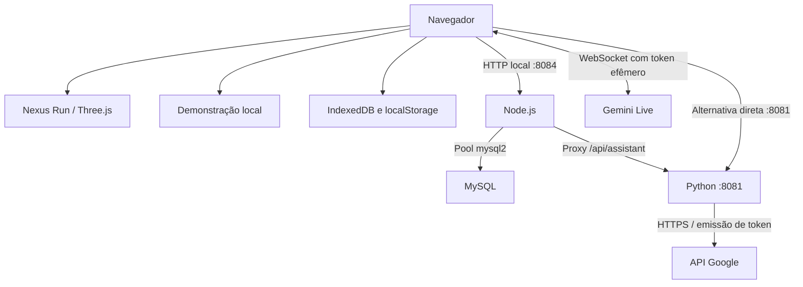

# NEXUS

Projeto acadêmico que reúne manequim tecnológico, hardware, infraestrutura virtual, jogo 3D e chatbot. O **Nexus** apresenta o projeto; no **Nexus Run**, o visitante controla sua representação digital em um universo virtual.

**UniFECAF · ExpoTech 2026.2 · Missão 2050** — contexto informado pela equipe. A relação com a temática e os resultados acadêmicos precisam de fundamentação; o código não comprova indicadores de impacto ambiental ou social.

**[Jogar Nexus Run no navegador](https://0matheus-silva.github.io/Mannequin-Run/)**

O GitHub Pages executa o jogo e a demonstração roteirizada. **Gemini Live e MySQL exigem os backends locais.** Pages e “Go Live” do VS Code não iniciam esses serviços.

## Funcionalidades

| Área | Implementação |
| --- | --- |
| Jogo | Runner 3D em três faixas, salto, deslize, obstáculos, componentes, pontuação e recordes |
| Modos | História com 2.400 m e encerramento; Infinito com setores em ciclo |
| Cenários | Laboratório Abandonado, Cidade em Ruínas, Complexo Industrial e Zona Contaminada |
| Visual e som | Personagem articulado, iluminação, sombras, névoa, partículas, bloom, música procedural e áudios locais |
| Encerramento | Chegada à UniFECAF, entrada, auditório, premiação, troféu e créditos |
| Controles | Teclado, gamepad com calibração, cursor azul nos menus e gestos mobile |
| Jogadores | Nome/apelido ao iniciar, UUID, histórico, ranking, checkpoints e conquistas |
| Persistência | MySQL, IndexedDB com sincronização, backup JSON e exportação CSV/JSON |
| Chatbot | Demonstração local, apresentação narrada e Gemini Live por texto/microfone |

Implementação não equivale a homologação em todos os dispositivos. DualSense físico, Android/iPhone e estabilidade Live no ambiente do evento ainda precisam de confirmação.

## Execução no Windows

Use PowerShell na raiz do projeto. Não abra `index.html` por duplo clique: os módulos precisam de HTTP.

| Necessidade | Inicializador | Endereço |
| --- | --- | --- |
| Jogo e demonstração | `Start-Game.ps1` | http://localhost:8080 |
| Jogo e Gemini, sem exigir MySQL | `Start-Assistant.ps1` | http://127.0.0.1:8081 |
| Versão completa com MySQL | `Start-Local.ps1` | http://127.0.0.1:8084 |

### Jogo e demonstração

Requer PowerShell e navegador compatível com WebGL. Os recursos do jogo são locais.

```powershell
powershell -ExecutionPolicy Bypass -File .\Start-Game.ps1
```

### Chatbot Gemini em outro computador

Requer **Python 3.11+**, internet e chave com acesso ao modelo configurado. O inicializador também aceita Python disponibilizado por `uv`.

Crie o arquivo local apenas se ele ainda não existir:

```powershell
if (-not (Test-Path .env)) { Copy-Item .env.example .env }
```

Preencha a chave somente no `.env`. Após revisar o público adulto e confirmar o projeto Google no nível gratuito, sem faturamento, configure:

```dotenv
GEMINI_API_KEY=COLE_SUA_CHAVE_SOMENTE_NO_ARQUIVO_LOCAL
GEMINI_ENABLED=true
GEMINI_AUDIENCE_REVIEW=approved-adults-only
GEMINI_FREE_TIER_CONFIRMED=true
GEMINI_LOCAL_DAILY_LIMIT=30
```

Essas opções registram confirmações locais; não verificam nem alteram a conta Google e não ativam faturamento. Não envie `.env`, chaves, senhas ou tokens ao GitHub.

```powershell
powershell -ExecutionPolicy Bypass -File .\Start-Assistant.ps1
```

Mantenha o terminal aberto e acesse **http://127.0.0.1:8081**. Abra **CONVERSAR COM NEXUS**, selecione **Gemini Live**, aceite o processamento externo e conecte. Use **CONHEÇA O NEXUS** para apresentar ou **ATIVAR MICROFONE** para conversar.

Mudanças no `.env` exigem reiniciar o Python. Variáveis de ambiente já definidas no processo têm prioridade sobre o arquivo.

### Versão completa com MySQL

Requisitos adicionais: **Node.js >=22.13** e **MySQL Community Server ativo**. Apenas Workbench não substitui o servidor. O esquema usa recursos MySQL 8; a instalação auditada utilizava 8.0.46.

Para preparar Node portátil, sem instalar serviço Windows:

```powershell
powershell -ExecutionPolicy Bypass -File .\tools\Prepare-Node.ps1
```

Com Node no PATH, a instalação direta de dependências é:

```powershell
npm ci --ignore-scripts --no-audit --no-fund
```

No `.env`, configure host, porta e credenciais administrativas **do MySQL desse computador**. Use um usuário exclusivo de aplicação. Em instalação nova, o provisionador pode gerar sua senha quando `MYSQL_PASSWORD` estiver vazio. Não sobrescreva credenciais existentes sem conferir o usuário correspondente no banco.

```powershell
# Primeira preparação.
powershell -ExecutionPolicy Bypass -File .\Start-Local.ps1 -Setup

# Próximas execuções.
powershell -ExecutionPolicy Bypass -File .\Start-Local.ps1
```

O inicializador prepara dependências Node se necessário, cria banco/tabelas/usuário e inicia ou reutiliza o Python. Não instala MySQL nem serviços Windows. Abra **http://127.0.0.1:8084**.

Baixar o repositório não transfere `.env`, perfis, banco ou dependências locais de outro PC.

### Diagnóstico

```powershell
powershell -ExecutionPolicy Bypass -File .\tools\Test-Local.ps1
```

O diagnóstico não imprime credenciais, emite tokens ou consome tentativa Gemini. `ready=true` confirma configuração local, sem comprovar cota ou acesso real ao Google.

## Como jogar

| Ação | Teclado | Gamepad padrão | Celular |
| --- | --- | --- | --- |
| Faixas | A/D ou ←/→ | Analógico ou direcional lateral | Deslizar para esquerda/direita |
| Pular | Espaço ou ↑ | X | Deslizar para cima |
| Deslizar | S ou ↓ | Círculo | Deslizar para baixo |
| Pausar | Esc | Options | Botão de pausa |
| Reiniciar após Game Over | R ou menu | Menu | Menu |

No celular, cada gesto executa uma ação; não há botões virtuais de movimento. Toques pequenos, cancelamentos e interações com formulários/chatbot são filtrados. Comece os gestos na área central, evitando as bordas reservadas à navegação do navegador.

Salte barreiras baixas, deslize sob estruturas elevadas e desvie de obstáculos altos. Cada componente vale **75 pontos**. Pontuação: `piso((distância − distância inicial) × 10 + componentes × 75)`. A velocidade cresce de **12 a 28 m/s**.

Cada setor tem 600 m, com transição nos 120 m finais. Os oito trechos de **CAPÍTULOS** permitem avaliação; partidas de prática não atualizam recordes normais.

## Arquitetura e tecnologias



O Python mantém a chave permanente no backend e emite tokens efêmeros. O áudio Live trafega diretamente entre navegador e Google. Os servidores escutam em loopback e validam origem/host. Exposição externa completa exige configuração própria de domínio, HTTPS e acesso aos backends.

- HTML, CSS e JavaScript com módulos ES.
- Three.js local, revisão 170 / linha 0.170.0.
- Node.js >=22.13 e mysql2: declarado `^3.15.3`, fixado no lock em `3.24.6` na auditoria.
- Python 3.11+, com bibliotecas da própria linguagem.
- MySQL 8, Web Audio, AudioWorklet, Gamepad API e Pointer Events.
- Modelo configurado: `gemini-3.8-live`; voz: **Sadachbia**.

## Chatbot e voz

A base [knowledge.json](assets/assistant/knowledge.json) e as instruções [personality.json](assets/assistant/personality.json) cobrem manequim físico, hardware, VM, jogo e chatbot. O encerramento convida a jogar Nexus Run.

| Modalidade | Comportamento |
| --- | --- |
| Demonstração local | Respostas roteirizadas, sem IA generativa ou reconhecimento de fala; apresentação WAV e voz local quando disponível |
| Gemini Live | Texto/microfone, resposta em áudio e transcrições; depende do Google e da configuração local |

**A narração local não é Sadachbia.** Os registros de geração do WAV utilizam System.Speech / Microsoft Maria Desktop. Sadachbia é a voz configurada para o Gemini.

A apresentação completa desliga o microfone para reduzir interrupções por eco e não o reativa automaticamente. Depois, use **ATIVAR MICROFONE**. A fila PCM aceita até três minutos de áudio futuro. Captura: PCM16 a 16 kHz; reprodução: taxa padrão de 24 kHz.

Limites atuais:

- **180 segundos por conexão**, mesmo com fala em andamento.
- **30 tentativas por dia/processo**, configuráveis em `GEMINI_LOCAL_DAILY_LIMIT` (1 a 1.000; inválido usa 30).
- Sem espera obrigatória entre reconexões.
- Tentativas recusadas pelo Google também podem consumir a contagem local.
- Contagem em memória; não é controle de faturamento.
- Sem renovação automática, session resumption, compressão de contexto ou reenvio automático do histórico.

O limite local não aumenta a cota Google. Erros são tratados sem troca automática para serviço pago. Disponibilidade do modelo e estabilidade precisam de verificação no ambiente de apresentação.

## Jogadores, banco e offline

O banco permanece **`mannequin_run`**, assim como identificadores antigos de armazenamento/backup, para preservar os dados após a mudança de nome.

| Tabela | Finalidade |
| --- | --- |
| `players` | UUID, nome/apelido e atividade |
| `runs` | Partidas, métricas, resultado e revisão |
| `progress` | Recordes, avanço e conclusão |
| `checkpoints` | Retomada em 600, 1.200, 1.800 e 2.300 m |
| `achievements` | Conquistas |
| `schema_migrations` | Migrações e checksums |

Há pool de até cinco conexões, consultas parametrizadas, transações, índices, chaves estrangeiras e validação da pontuação. Homônimos são diferenciados por UUID. O ranking apresenta até dez jogadores; o servidor retorna até cem partidas por histórico.

IndexedDB mantém perfis, partidas e operações pendentes. O progresso é capturado por eventos e a cada quinze segundos, com sincronização MySQL. Fechamento abrupto pode perder o intervalo ainda não capturado. Não há Service Worker para cache completo ou primeira visita offline.

Nome/UUID e CSRF não constituem autenticação individual. O ranking é local ao banco; não há ranking público entre computadores ou sistema antifraude completo. Trocar/encerrar visitante limpa a conversa; os perfis permanecem até exclusão.

### Backup e exportação

Com Node no PATH:

```powershell
npm run db:setup
npm run db:migrate
npm run db:backup
npm run db:export
node tools/database.js restore CAMINHO_DO_BACKUP
```

Backup JSON e exportação CSV ficam em `.data/backups`, fora do Git. A interface também exporta JSON. A restauração exige banco de jogadores vazio; não há backup automático agendado.

## Manequim, hardware e VM

Informações **declaradas pela equipe e registradas na base**, sem inventário físico independente nesta auditoria:

| Computador físico | Especificação informada |
| --- | --- |
| CPU | Intel Core i7-9700F, 3,00 GHz |
| RAM | 32 GB a 2.133 MHz |
| GPU | NVIDIA GeForce RTX 3050, 8 GB dedicados |
| Armazenamento | SSD de 238 GB |
| Placa-mãe | B360M AORUS Gaming 3 |

A infraestrutura descrita utiliza **Windows Server 2022, IIS e ngrok**, com VM de referência de **4 GB de RAM, dois processadores virtuais e disco de 40 GB**. Esses recursos não são os recursos totais do computador físico.

O personagem reproduz roupa preta, capuz, máscara ciano e componentes no tórax. Não foi localizada automação por sensores, serial, USB, Bluetooth ou MQTT: a integração comprovada é visual e conceitual. Não há imagem reproduzível da VM nem comprovação atual de IIS/túnel ativos.

## Equipe e créditos

Responsabilidades informadas pela equipe:

| Integrante | Responsabilidade |
| --- | --- |
| Matheus | Desenvolvimento do jogo e do chatbot |
| Pedro | Máquinas virtuais e participação na caracterização do manequim |
| Vitor | Participação na caracterização do manequim |

**Nos créditos do jogo, permanecem os nomes completos:**

- Fabiano Matheus de Camargo Silva.
- Pedro Henrique Freitas de Oliveira.
- Vitor Barioni Ferraz.

**Na fala do Nexus, permanecem os primeiros nomes já configurados: Matheus, Pedro e Victor.** A diferença é intencional. A apresentação oral reconhece autoria coletiva, sem separar tarefas por integrante.

## Testes e validação

```powershell
npm test
node --test tests/swipe-input.test.js
python -B -m unittest discover -s tests -p test_assistant_server.py
```

As suítes cobrem validação/persistência, gamepad, coleta no deslize, conteúdo, voz, PCM, gestos e Python com provedor simulado. `npm test` não inclui gestos, por isso essa suíte aparece separadamente.

Integração MySQL:

```powershell
npm run test:mysql
```

**Esses testes podem gravar e excluir dados de teste.** A restauração pode ser ignorada quando há jogadores. Não são comandos de auditoria somente de leitura. Páginas em `tests/` cobrem mecânicas, setores, narrativa, áudio, menus, câmera e perfis; algumas escrevem no armazenamento do navegador.

Evidências anteriores lidas na auditoria: mobile com 13 verificações, chatbot/desktop com 44 e perfis MySQL com 19 em cada registro Edge/Chrome, todos `ALL PASS`. Há sobreposição: não somar como testes independentes. Relatórios `.tmp-qa` são locais e não acompanham o Git.

A auditoria principal não reexecutou suítes. Posteriormente, os **17 testes Python passaram** após a mudança do limite diário, com provedor simulado e sem consumo de cota Gemini. Isso não comprova disponibilidade externa ou compatibilidade física.

## Limitações e validações pendentes

- **Câmera mobile:** `resizeView()` calcula campo de visão adaptado, mas `Game.update()` o conduz novamente a 48°/50°; a adaptação não é mantida durante toda a execução.
- **Apresentação Live:** o temporizador de 180 segundos pode cortar a fala; falta teste real repetido.
- **Dispositivos:** homologar DualSense e aparelhos Android/iPhone do evento.
- **Outro PC:** confirmar dependências, `.env`, serviços e funcionamento real.
- **Hospedagem:** não há implantação externa completa validada dos backends e banco.
- **Infraestrutura:** complementar fotos, diagrama elétrico, inventário, hipervisor, rede e evidências operacionais.
- **Acadêmico:** complementar objetivos, justificativa, relação com Missão 2050, resultados e avaliação.
- **Operação:** definir retenção de dados, backup agendado, contingência e supervisão.
- **Licenciamento:** confirmar licença do projeto e autorização dos recursos; veja `assets/vendor/three/LICENSE` e `assets/audio/ceremony/ORIGEM-E-LICENCA.md`.

Não há implementação confirmada de aplicativo nativo, PWA com cache completo, login individual, ranking público, automação física do manequim ou recursos hápticos específicos. QR Code permanece fora do escopo. Esses itens não constituem roadmap aprovado.

## Estrutura e guias

```text
assets/     Recursos, áudio, base do chatbot e Three.js
src/        Jogo, personagem, ambientes, interface, áudio e perfis
server/     Backend Python, backend Node e camada MySQL
styles/     Estilos desktop, chatbot, perfis e mobile
tests/      Suítes e páginas de validação
tools/      Diagnóstico, banco, áudio e ferramentas
docs/       Guias e relatórios técnicos
```

- [Configuração Gemini](docs/GEMINI-LOCAL.md)
- [Executar em outro computador](docs/OUTRO-PC.md)
- [MySQL, jogadores, backup e DualSense](docs/MYSQL-JOGADORES-DUALSENSE.md)
- [Controles mobile](docs/MOBILE.md)
- [Continuidade da apresentação](docs/CONTINUIDADE-APRESENTACAO.md)
- [GitHub Pages e versão completa](docs/EXECUCAO-GITHUB.md)
- [Nomenclatura e compatibilidade dos dados](docs/NOMENCLATURA.md)

**Referência documental:** auditoria de 15/11/2026 sobre `69a9b8d`, complementada pelo limite configurável em `47cd987`. Relatórios antigos em `docs/` registram entregas anteriores e podem conter descrições superadas; o código atual prevalece.
